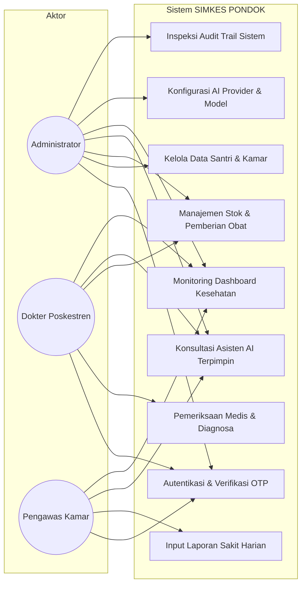
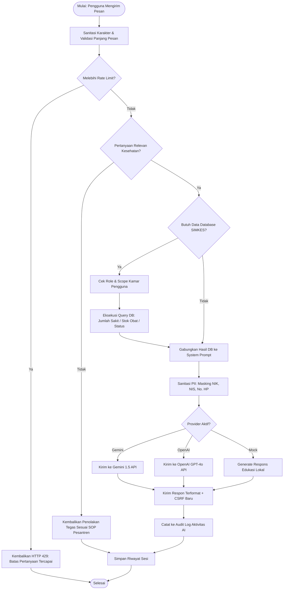
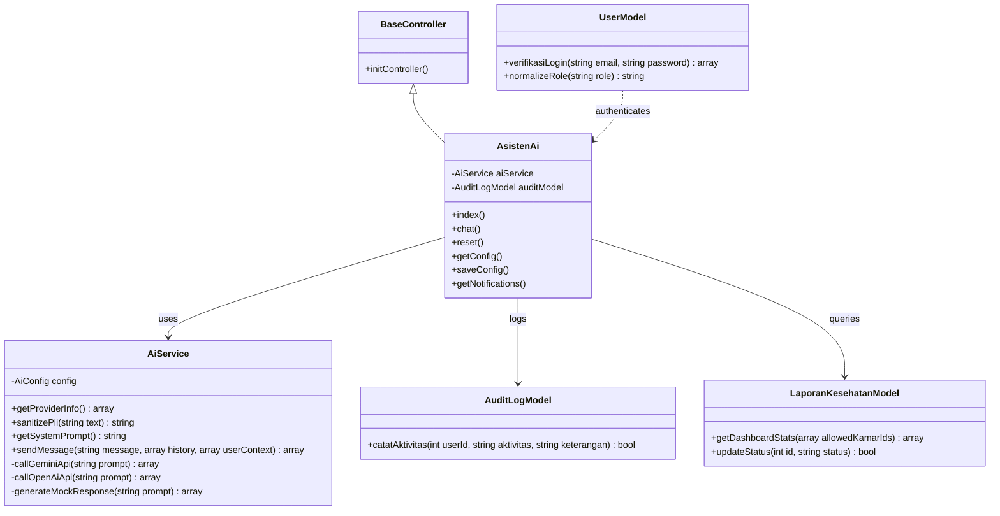
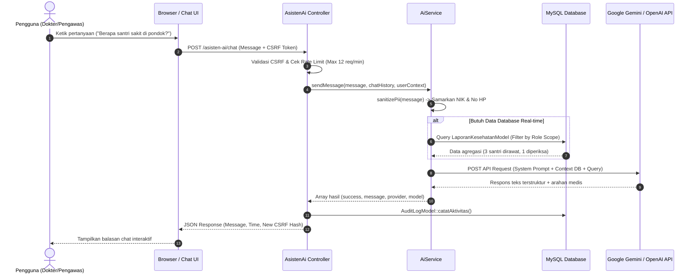
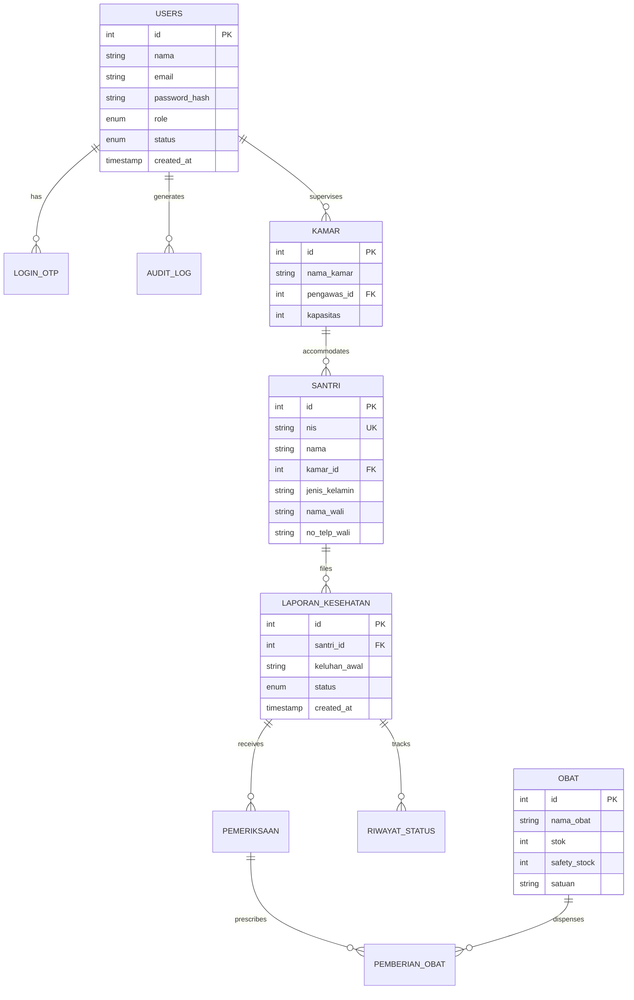

# SIMKES PONDOK — Sistem Informasi Kesehatan Pondok Pesantren Berbasis Web & Kecerdasan Artifisial

[](https://github.com/muhammadhaidirali001-prog/proyek-rpl-simkes-pondok/actions)
[](https://www.php.net/)
[](https://codeigniter.com/)
[](https://www.mysql.com/)
[](https://ai.google.dev/)
[](LICENSE)

> **Proyek Akhir Rekayasa Perangkat Lunak (TIKB2503021) — Semester 3**  
> **Program Studi S1 Teknik Informatika — STMIK IKMI Cirebon**  
> **Dosen Pengampu:** Yudhistira Arie Wijaya, M.Kom., CDS.  
> **Kurikulum:** Berbasis Outcome-Based Education (OBE)  

---

## 📌 Identitas Mahasiswa & Kelompok

| Data | Keterangan |
| :--- | :--- |
| **Nama Pengembang Mandiri** | **Muhammad Haidir Ali** |
| **Nomor Induk Mahasiswa (NIM)** | **41257211** |
| **Peran Pengembang** | **Full-Stack Software Engineer & AI System Integrator** (100% Individual Ownership & Full-App Build) |
| **Kelompok** | **Kelompok 6** |
| **Tema Topik Kelompok** | **SPPG Cangkring / Smart Healthcare & Public Service AI** |
| **Judul Aplikasi Mandiri** | **SIMKES PONDOK (Sistem Informasi Kesehatan Santri Berbasis Web & AI Terintegrasi)** |
| **Repositori GitHub Publik** | `https://github.com/muhammadhaidirali001-prog/proyek-rpl-simkes-pondok` |

### 👥 Anggota Kelompok 6 (Group Topic Theme: SPPG Cangkring)
Setiap anggota kelompok menyepakati tema payung kelompok yang sama, namun memegang kepemilikan utuh aplikasi independen dari awal hingga akhir (PRD → UML → UI/UX → Web Code → AI Integration → Testing → CI/CD):
1. **Moh Nur Ariqul Fauzi** (NIM: 41257205)
2. **Muhammad Fauzan** (NIM: 41257209)
3. **Muhammad Haidir Ali** (NIM: 41257211) — *SIMKES PONDOK*
4. **Nur Fajar Sidik** (NIM: 41257220)
5. **Yoga Satria Alfaritzi** (NIM: 41257231) — *SPPG Cangkring MBG*
6. **Muhammad Ibnu Saefullah** (NIM: 41257206)

---

## 📖 Deskripsi Eksekutif Aplikasi

**SIMKES PONDOK** adalah aplikasi web rekam medis, manajemen inventaris obat, dan kewaspadaan dini kesehatan santri yang dirancang khusus untuk ekosistem pondok pesantren. Mengintegrasikan tata kelola kesehatan asrama bertingkat dengan **Asisten AI Klinis Real-Time**, sistem ini mentransformasikan alur pencatatan manual yang lambat dan rentan tercecer menjadi satu platform digital terpadu yang transparan, terukur, dan aman.

### 🎯 Masalah Nyata yang Diselesaikan (Problem Statement)
1. **Keterlambatan Penanganan Santri Sakit:** Gejala awal santri di asrama seringkali baru diketahui tim medis Poskestren setelah kondisi memburuk karena tidak adanya pelaporan digital seketika dari pengawas kamar.
2. **Riwayat Medis & Distribusi Obat yang Tercecer:** Catatan buku manual rentan hilang, memicu kekeliruan pemberian obat ganda, atau ketidaktahuan atas riwayat alergi santri.
3. **Kekosongan Stok Obat Darurat:** Pengurus terlambat menyadari stok paracetamol, antasida, atau antiseptik menipis akibat ketiadaan notifikasi *safety stock*.
4. **Kecemasan Orang Tua / Wali Santri:** Wali santri kesulitan memantau status kesehatan putra-putrinya selama masa isolasi atau perawatan asrama.

---

## 🤖 Fitur Kecerdasan Artifisial (AI Features)

Aplikasi ini dilengkapi dengan modul **Asisten AI Kesehatan Santri** yang dirancang mematuhi standar *Privacy by Design*, etika medis klinis, dan batasan operasional pesantren:

### 1. Medical Domain Guardrails & Strict Scope Filter
* **Penyaring Domain Ketat:** AI dipagari oleh *system prompt* khusus yang mewajibkan asisten hanya merespons topik kesehatan santri, P3K, sanitasi asrama, penjelasan istilah medis umum, serta tanda bahaya (*red flags*).
* **Penolakan Lugas Non-Kesehatan:** AI secara tegas dan terstandar menolak pertanyaan koding, matematika, politik, hiburan, game, atau obrolan di luar domain kesehatan:
  > *"Mohon maaf, saya adalah Asisten Kesehatan SIMKES Santri. Saya hanya melayani pertanyaan seputar kesehatan santri, gejala penyakit, pertolongan pertama, istilah medis, dan sanitasi asrama pesantren..."*
* **Etika Klinis & Anti-Vonis:** AI dilarang keras memberikan diagnosis definitif atau menetapkan dosis obat keras/antibiotik secara mandiri tanpa pemeriksaan dokter Poskestren.
* **Disclaimer Medis Otomatis:** Setiap respons menyertakan penegasan bahwa saran bersifat edukatif dan santri harus segera dirujuk ke faskes bila terdapat keluhan berlanjut.

### 2. Contextual Natural Language Database Assistant (RAG / DB Reader)
* **Pencarian Data Berbasis Bahasa Alami:** Pengguna dapat menanyakan data operasional secara langsung ke chatbot (misal: *"Berapa santri yang sedang dirawat saat ini?"*, *"Sebutkan santri yang sakit di Kamar Abu Bakar"*, *"Bagaimana sisa stok obat Paracetamol?"*).
* **Role-Based Data Access:**
  * **Dokter / Tim Medis / Admin:** Memperoleh akses agregasi data riil santri sakit, kamar asrama, rekam diagnosa, hingga riwayat pemberian obat di seluruh pondok.
  * **Pengawas Kamar:** Dibatasi hanya dapat membaca data kesehatan santri pada kamar binaan yang diampunya, menjaga kerahasiaan data santri antar-kamar.
* **Sanitasi PII (Privacy by Design):** Sebelum dikirim ke provider AI publik, data pribadi sensitif (NIK 16-digit, nomor WhatsApp wali, NIS, dan nama lengkap tertentu) disamarkan (*masked*) secara otomatis oleh modul `sanitizePii()`.

### 3. Dynamic Multi-Provider & Model Switcher
* **Fleksibilitas Mesin AI:** Mendukung transisi mesin AI secara instan tanpa perlu merestart server web:
  * **Google Gemini API** (`gemini-1.5-flash`, `gemini-1.5-pro`) — Respon cepat, kuota efisien, dan penalaran klinis yang tajam.
  * **OpenAI API** (`gpt-4o-mini`, `gpt-4o`) — Pilihan alternatif kelas industri.
  * **Verified Mock Simulation (Offline Mode)** — Berjalan penuh tanpa koneksi internet atau tanpa API key dengan dataset rule-based medis terverifikasi.
* **Keamanan Kredensial:** API Key disimpan terenkripsi di sisi server, dimasking (`••••••••`), dan tidak pernah dibocorkan ke elemen inspect HTML maupun response payload klien.

---

## 🏛️ Arsitektur Sistem & Prinsip Rekayasa (Clean Code & SOLID)

Aplikasi dibangun menggunakan pola arsitektur **Model-View-Controller (MVC)** dengan mematuhi prinsip **SOLID**:
* **Single Responsibility Principle (SRP):** Pemisahan tegas antara `AiService` (logika interaksi AI & sanitasi PII), `AuditLogModel` (pencatatan keamanan), `LaporanKesehatanModel` (query data klinis), dan controller penanganan HTTP.
* **Open/Closed Principle (OCP):** Engine AI didesain berbasis antarmuka provider yang mudah diperluas ke model lain (DeepSeek / Anthropic Claude) tanpa merombak controller utama.
* **Liskov Substitution Principle (LSP):** Seluruh model mewarisi CodeIgniter `Model` dengan kontrak CRUD dan sanitasi query yang seragam.
* **Interface Segregation Principle (ISP):** Kontrak fungsi spesifik untuk verifikasi OTP, manajemen inventaris obat, dan audit aktivitas.
* **Dependency Inversion Principle (DIP):** Dependency injection pada controller untuk memudahkan penulisan *unit test* dan *mocking*.

### 🔒 Keamanan Siber Aplikasi
* **Otentikasi Berlapis (2FA / OTP):** Verifikasi kode OTP 6-digit otomatis dikirim ke email via Gmail SMTP TLS.
* **Role-Based Access Control (RBAC):** Pemisahan 4 tingkatan hak akses: `Admin`, `Dokter`, `Petugas Kesehatan`, dan `Pengawas Kamar`.
* **CSRF Protection:** Token dan hash CSRF diperbarui otomatis pada setiap interaksi formulir dan AJAX.
* **Bcrypt Password Hashing:** Seluruh kata sandi pengguna dienkripsi searah menggunakan algoritma Blowfish/Bcrypt.
* **Audit Trail:** Seluruh aksi manipulasi data, perubahan status santri, dan konsultasi AI dicatat ke dalam tabel `audit_log`.

---

## 📐 Pemodelan UML & Arsitektur Sistem

### 1. Use Case Diagram


### 2. Activity Diagram: Alur Konsultasi & Kueri Database AI


### 3. Class Diagram (Prinsip SOLID)


### 4. Sequence Diagram: Interaksi Frontend, Backend, Database, & AI API


### 5. Entity-Relationship Diagram (ERD Basis Data)


---

## 🛠️ Tumpukan Teknologi (Tech Stack)

| Lapisan | Teknologi / Pustaka | Kegunaan |
| :--- | :--- | :--- |
| **Backend Core** | PHP 8.2 / 8.3 + CodeIgniter 4.4 | MVC Framework, routing, filtering, database migrations |
| **Frontend UI/UX** | HTML5, CSS3, JavaScript (ES6+), Bootstrap 5.3, Bootstrap Icons | Antarmuka dashboard responsif, live chat panel, modal konfigurasi |
| **Database** | MySQL 8.0 / MariaDB 10.4+ | Relational data persistence, indexed foreign keys, InnoDB ACID |
| **Kecerdasan Artifisial** | Google Gemini 1.5 Flash API & OpenAI GPT-4o-mini | Natural Language Processing, clinical reasoning, database context retrieval |
| **Mailing & Otentikasi** | PHPMailer / CI4 Email Service (Gmail SMTP TLS) | Pengiriman token 2FA/OTP ke email pengguna secara real-time |
| **Unit Testing** | PHPUnit 10.5+ | Pengujian otomatis modul AI, RBAC, CRUD, dan integritas keamanan |
| **DevOps & CI/CD** | GitHub Actions (`.github/workflows/ci.yml`) | Otomatisasi integrasi berkelanjutan (linting, build, unit test execution) |

---

## 📁 Struktur Repositori & Direktori Proyek

```
proyek-rpl-simkes-pondok/
├── .github/
│   └── workflows/
│       └── ci.yml               # Pipeline CI/CD GitHub Actions (Testing Otomatis)
├── app/
│   ├── Config/
│   │   ├── Ai.php               # Konfigurasi Provider, Model, Token, & Timeout AI
│   │   ├── Routes.php           # Routing RBAC, Auth, Medis, & Endpoint Asisten AI
│   │   └── Database.php         # Konfigurasi Koneksi MySQL/MariaDB
│   ├── Controllers/
│   │   ├── AsistenAi.php        # Controller Utama AI (Chat, Config, DB Query, Notifikasi)
│   │   ├── Auth.php             # Login, Register, 2FA OTP, & Session Management
│   │   ├── Dashboard.php        # Ringkasan Statistik Kesehatan & Metrik Santri
│   │   ├── DataTransfer.php     # Impor & Ekspor Data Excel/CSV Santri & Rekam Medis
│   │   ├── LaporanKesehatan.php # Pelaporan Keluhan Santri Sakit dari Kamar
│   │   ├── Pemeriksaan.php      # Rekam Diagnosa Medis & Tindakan Dokter Poskestren
│   │   ├── Obat.php             # Inventaris Stok & Peringatan Safety Stock Obat
│   │   ├── PemberianObat.php    # Distribusi Terjadwal Obat ke Santri
│   │   ├── Santri.php           # Master Data Santri & Riwayat Asrama
│   │   ├── Users.php            # Manajemen Pengguna & Hak Akses RBAC
│   │   └── AuditLog.php         # Pencatatan Jejak Forensik Aktivitas Sistem
│   ├── Libraries/
│   │   └── AiService.php        # Engine Inti AI: Sanitasi PII, Guardrails, & Provider API
│   ├── Models/
│   │   ├── SantriModel.php
│   │   ├── LaporanKesehatanModel.php
│   │   ├── PemeriksaanModel.php
│   │   ├── ObatModel.php
│   │   ├── AuditLogModel.php
│   │   └── UserModel.php
│   └── Views/
│       ├── asisten_ai/          # Tampilan Chat AI & Modal Pengaturan Provider/Model
│       ├── auth/                # Halaman Login & Verifikasi Kode OTP Email
│       ├── dashboard/           # Tampilan Metrik & Grafik Status Kesehatan
│       └── layouts/             # Template Master Dashboard Responsif
├── docs/                        # Berkas Dokumentasi Resmi Proyek Akhir
│   ├── PRD.pdf                  # Product Requirement Document (IEEE 830 / ISO 29148)
│   ├── SDD.pdf                  # Software Design Document & Diagram UML Lengkap
│   └── testing.pdf              # Laporan Pengujian Otomatis & Hasil CI/CD
├── tests/
│   ├── test_ai_assistant.php    # Unit Test Ekstensif Modul AI (Guardrail, PII, DB Reader)
│   ├── test_auth_scenarios.php  # Pengujian Kasus Otentikasi & Validasi OTP
│   ├── test_security_audit.php  # Verifikasi Pencegahan Injeksi & Audit Log
│   └── test_santri_module.php   # Pengujian Fungsionalitas Modul Santri
├── .env.example                 # Contoh Variabel Lingkungan & Konfigurasi Sistem
├── composer.json                # Pustaka & Dependensi PHP
├── phpunit.dist.xml             # Konfigurasi Eksekusi Uji PHPUnit
└── README.md                    # Dokumentasi Utama Proyek (Halaman Ini)
```

---

## 🚀 Petunjuk Instalasi & Menjalankan Aplikasi (Setup Instruction)

Ikuti langkah-langkah berikut untuk menjalankan sistem di komputer lokal (Windows / Linux / macOS) menggunakan Laragon, XAMPP, atau PHP Built-in Server:

### 1. Prasyarat Sistem
* PHP versi **8.2** atau **8.3**
* Ekstensi PHP aktif: `ext-curl`, `ext-intl`, `ext-mbstring`, `ext-mysqli`, `ext-openssl`, `ext-json`
* MySQL versi **5.7+** atau MariaDB **10.4+**
* Composer versi **2.x**

### 2. Kloning Repositori
```bash
git clone https://github.com/muhammadhaidirali001-prog/proyek-rpl-simkes-pondok.git
cd proyek-rpl-simkes-pondok
```

### 3. Instalasi Dependensi Composer
```bash
composer install
```

### 4. Konfigurasi Environment (`.env`)
Salin berkas template `.env.example` menjadi `.env`:
```bash
# Windows PowerShell
copy env .env

# Linux / macOS
cp env .env
```
Buka file `.env` menggunakan teks editor dan sesuaikan pengaturan database serta AI:
```ini
CI_ENVIRONMENT = development

app.baseURL = 'http://localhost:8080/'
app.appTimezone = 'Asia/Jakarta'
app.defaultLocale = 'id'

# Pengaturan Database MySQL
database.default.hostname = 127.0.0.1
database.default.database = simkes_santri
database.default.username = root
database.default.password = 
database.default.DBDriver = MySQLi
database.default.port = 3306

# Pengaturan Provider AI (Opsional - Jika kosong, sistem otomatis masuk Mode Simulasi Terverifikasi)
AI_PROVIDER = 'gemini'
AI_API_KEY = 'MASUKKAN_GOOGLE_GEMINI_API_KEY_ANDA_DI_SINI'
AI_MODEL = 'gemini-1.5-flash'
AI_TIMEOUT = 15
AI_MAX_TOKENS = 800

# Konfigurasi SMTP Email (Untuk Fitur OTP Login)
email.protocol = 'smtp'
email.SMTPHost = 'smtp.gmail.com'
email.SMTPPort = 587
email.SMTPCrypto = 'tls'
email.SMTPUser = 'email-anda@gmail.com'
email.SMTPPass = 'app-password-gmail-16-digit'
```

### 5. Setup Database & Seeding Data Awal
Pastikan service MySQL telah berjalan di Laragon/XAMPP. Jalankan migrasi dan seeder data awal otomatis melalui CLI:
```bash
php spark migrate
php spark db:seed DatabaseSeeder
```
*Atau buat database bernama `simkes_santri` di phpMyAdmin, kemudian impor berkas `database.sql` yang disediakan di folder `database/`.*

### 6. Menjalankan Server Lokal
Jalankan server pengembangan bawaan CodeIgniter:
```bash
php spark serve --port 8080
```
Buka peramban (browser) dan akses: **`http://localhost:8080`**

### 🔑 Akun Uji Coba Bawaan (Default Credentials)

| Role Pengguna | Email Login | Kata Sandi | Hak Akses Utama |
| :--- | :--- | :--- | :--- |
| **Administrator** | `admin@simkes.pesantren.id` | `PesantrenSehat2026!` | Hak penuh: Kelola User, Setup AI, Audit Trail, Master Data |
| **Dokter Poskestren** | `dr.fatimah@simkes.pesantren.id` | `PesantrenSehat2026!` | Pemeriksaan Medis, Diagnosa Klinis, Resep Obat, Akses AI Medis Penuh |
| **Petugas Kesehatan**| `perawat.rahmat@simkes.pesantren.id` | `PesantrenSehat2026!`| Distribusi Obat, Monitoring Perawatan, Triase Santri |
| **Pengawas Kamar** | `pengawas.hilman@simkes.pesantren.id` | `PesantrenSehat2026!`| Input Keluhan Santri, Monitoring Asrama, AI Kamar Binaan |

---

## 🧪 Pengujian Otomatis (Automated Testing) & DevOps CI/CD

Aplikasi ini mengimplementasikan pengujian otomatis menyeluruh untuk menjamin keandalan sistem sebelum proses deployment.

### Menjalankan Unit Test Lokal
Eksekusi rangkaian pengujian unit test dan validasi integrasi AI:
```bash
# Menjalankan seluruh pengujian unit test otomatis
php vendor/bin/phpunit

# Menjalankan pengujian spesifik Modul Integrasi AI & Keamanan
php tests/test_ai_assistant.php

# Menjalankan pengujian skenario autentikasi & OTP
php tests/test_auth_scenarios.php
```

### Integrasi Berkelanjutan: GitHub Actions CI/CD Pipeline
Alur integrasi otomatis terkonfigurasi pada berkas `.github/workflows/ci.yml`. Setiap operasi `push` atau `pull_request` ke branch `main` / `master` akan memicu otomasi:
1. **Linting & Code Syntax Verification:** Memastikan tidak ada galat sintaksis PHP.
2. **Environment Bootstrapping:** Menyiapkan runtime PHP 8.2 & 8.3 beserta modul pendukung.
3. **Database Spin-up:** Menjalankan instance service MySQL di runner GitHub Actions.
4. **Automated Migration & Seeding:** Memverifikasi integritas skema database.
5. **Automated Test Execution:** Menjalankan seluruh suite pengujian dengan status kelulusan hijau (*passing badge*).

---

## 🎥 Tautan Video Presentasi & Live Demo (Sesuai Panduan OBE)

Berdasarkan ketentuan kurikulum OBE mata kuliah Rekayasa Perangkat Lunak, presentasi video berikut memverifikasi autentisitas pengerjaan mandiri, penguasaan pemodelan UML, serta demonstrasi aplikasi real-time dengan webcam mahasiswa aktif:

| Tahapan Video | Durasi | Topik Pembahasan | Tautan Video |
| :--- | :---: | :--- | :---: |
| **Video Progres 1: PRD & Konsep Aplikasi** | 3–5 Menit | Pembahasan identifikasi masalah nyata pesantren, analisis kebutuhan fungsional & non-fungsional, serta peran strategis fitur AI yang ditanamkan. | [Tonton di YouTube / Google Drive](https://youtube.com/watch?v=CONTOH_VIDEO_PROGRES_1) |
| **Video Progres 2: Pemodelan UML & UI/UX** | 5–7 Menit | Pembedahan mendalam 4 Diagram UML Utama (Use Case, Activity, Class SOLID, Sequence Diagram) dan demonstrasi walkthrough prototipe interaktif UI/UX Figma. | [Tonton di YouTube / Google Drive](https://youtube.com/watch?v=CONTOH_VIDEO_PROGRES_2) |
| **Video Final: Live Demo Aplikasi Web & Sistem Utuh** | 8–12 Menit | Elevator Pitch, arsitektur sistem, Live Demo utuh fitur aplikasi web, demonstrasi real-time Asisten AI (Guardrails & DB Reader), pembuktian Unit Test, dan status hijau CI/CD Actions. | [Tonton di YouTube / Google Drive](https://youtube.com/watch?v=CONTOH_VIDEO_FINAL_DEMO) |

> 🌐 **Tautan Aplikasi Web Live (Cloud Deployed):**  
> `https://simkes-pondok.live` *(atau tautan deployment hosting aktif)*

---

## 📑 Berkas Dokumentasi Terpadu (PDF Tunggal)

Seluruh berkas rekayasa perangkat lunak telah disusun secara komprehensif sesuai standar IEEE 830 / ISO 29148 dan tersedia di direktori `docs/`:
* 📄 **[Dokumen PRD / SRS](docs/PRD.pdf):** Memuat latar belakang, daftar *User Stories*, kriteria penerimaan (*Acceptance Criteria*), dan spesifikasi kebutuhan non-fungsional.
* 📄 **[Dokumen SDD / UML](docs/SDD.pdf):** Memuat perancangan arsitektur berorientasi objek, diagram sekuensial pertukaran pesan AI, ERD fisik, kamus data, dan tautan Figma.
* 📄 **[Laporan Pengujian & CI/CD](docs/testing.pdf):** Matriks pengujian fungsionalitas, bukti eksekusi *unit test*, serta riwayat integrasi pipeline GitHub DevOps.

---

## ⚖️ Pernyataan Akuntabilitas & Keaslian Karya

Saya yang bertanda tangan di bawah ini:
* **Nama:** Muhammad Haidir Ali
* **NIM:** 41257211
* **Program Studi:** S1 Teknik Informatika — STMIK IKMI Cirebon

Menyatakan dengan sesungguhnya bahwa aplikasi web **SIMKES PONDOK** beserta seluruh kode program, rancangan arsitektur UML, integrasi modul AI, skrip pengujian unit test, dan konfigurasi CI/CD merupakan hasil karya mandiri saya secara penuh (*100% Individual Ownership & Full-App Build*) untuk memenuhi Ujian Akhir Semester Mata Kuliah Rekayasa Perangkat Lunak Tahun Akademik 2026/2027.

---
*Dibuat dengan dedikasi untuk kemajuan teknologi kesehatan di lingkungan Pondok Pesantren Indonesia.*
